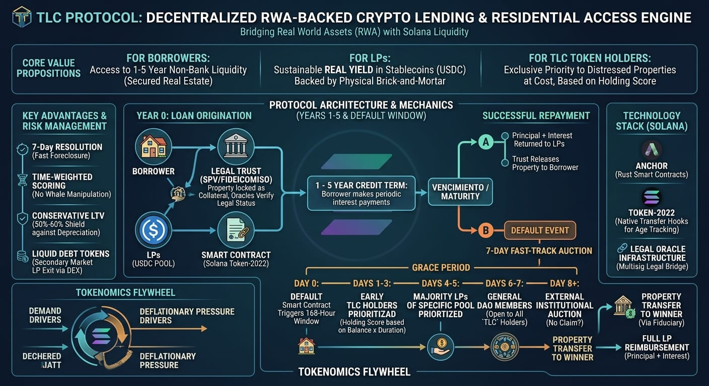

# SARAHI: Solana Agent Real State via Artificial Hackathon Intelligence

SARAHI is an AI agent on Solana that issues loans in **USDC or WBTC** against a **tokenized house** (a real-world asset, RWA) held in a legal trust. Built for the Solana Hackathon (MLH). Current network: **Devnet**.

> Status: hackathon prototype. The program is **unaudited** and uses test funds only. Do not use it with real money.

**Live demo (simulated, no wallet needed):** https://claude.ai/artifact/CT1ZEncrxJnCCCywWcmhBB

## The problem

Banks make home financing slow and expensive. Crypto investors want yield backed by real assets. SARAHI connects both sides: owners get fast liquidity from a pool of lenders, and lenders earn yield backed by physical property.

## About the idea
SARAHI (acronym in English: Solana Agent Real State via Artificial Hackathon Intelligence) 
Is AI is issuing crypto loans (USDC, WBTC) by using a "REAL WORLD ASSET" (here Real State) as collateral
You can read the full idea in this [pdf](https://github.com/hbelloma/SARAHI_agent/blob/8a0122edbee895b5a743c23c4daf67c4a5bc271f/RWA%26cryptolending_eng.pdf)
Here is the schematic picture 

This dApp will be added (as another agent) as a complement of another bigger idea see [Dashiagitbub](https://github.com/hbelloma/Dashia-agent-app_v0_2) (Authomatic trading agents) as a general dapp project called TwoLevelCapital, and SARAHI Will be an extra feature (lending mechanism for borrow liquidity) that will be a use of case of a token ($TLC) in future.

## How it works

1. **Register:** the owner registers a property (appraisal plus the hash of the trust document) in a PDA account.
2. **Verify:** a legal oracle confirms the deed is held in the trust (an SPV).
3. **Approve:** the SARAHI agent reviews the request and signs the credit. The program rejects any loan above **50% of the appraisal**, so collateral is at least 200% of the loan.
4. **Fund:** the pool vault sends the loan to the borrower’s wallet. The property moves to *Encumbered*.
5. **Repay:** the borrower pays principal plus simple interest and the property moves to *Released*.
6. **Default:** if the loan matures unpaid, anyone can mark the default. A **168-hour auction window** opens and the property moves to *Foreclosing*.

Auction priority follows the TLC protocol design: days 1 to 3 go to TLC token holders ranked by holding time, days 4 to 5 to pool lenders, and days 6 to 7 to the public.

## Repository layout

| Path | Contents |
|---|---|
| `programs/sarahi/src/lib.rs` | Anchor program: config, property registration and verification, liquidity, loans, repayment, default |
| `demo/sarahi_demo.html` | Simulated visual demo (not connected to the chain) |
| `Anchor.toml`, `Cargo.toml` | Workspace configuration (Devnet) |

Program instructions: `initialize_config`, `register_property`, `verify_property`, `deposit_liquidity`, `open_loan`, `repay_loan`, `mark_default`.

## What is simulated today

- The demo’s agent follows fixed rules, not a language model, and its transaction signatures are placeholders.
- Interest rates (9% for USDC, 7% for WBTC) are illustrative.
- The on-chain program has not been deployed or tested on Devnet yet.

## Roadmap

- On-chain 7-day auction with priority by TLC holding time (Token-2022 transfer hooks).
- Lender accounting (pool shares, a tUSDC position token) and interest distribution.
- WBTC price oracle and periodic re-appraisals.
- TypeScript client (Codama), integration tests (Surfpool or LiteSVM), and the live AI agent.
- Security audit.

## Build and deploy to Devnet

Requires Rust, the Solana CLI, and Anchor.

```bash
solana config set --url devnet
solana airdrop 2
anchor keys sync      # replaces the placeholder program id
anchor build
anchor deploy --provider.cluster devnet
```

If `anchor build` fails on versions, adjust `anchor-lang` and `anchor-spl` in `programs/sarahi/Cargo.toml` to match your install.

## Design notes

- Amounts use the token’s smallest unit (USDC has 6 decimals).
- Interest is simple over the full term: `principal × rate × term / year`.
- The agent and oracle are keys stored in `Config`. In production they should be multisigs.
- Loan and property accounts are PDAs seeded by the property and its owner.

## Credits

Based on the TLC Protocol design for on-chain mortgage lending. Built with Anchor and the Solana Foundation developer skill.
